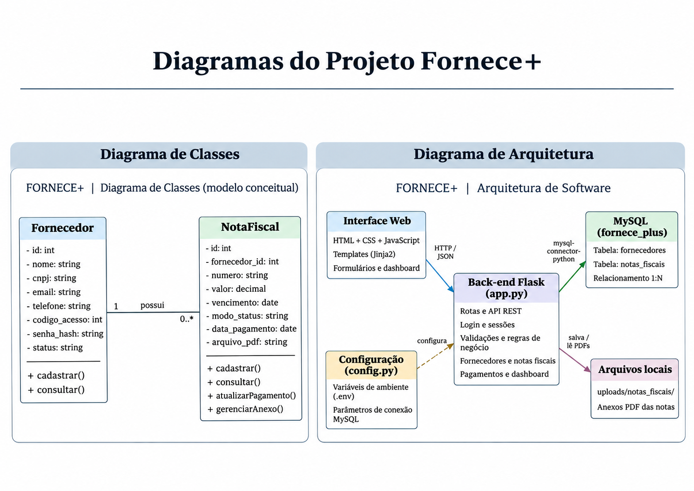

# Fornece+

Projeto acadêmico para controle de fornecedores e notas fiscais.

## Tecnologias

- Python 3 e Flask
- MySQL com `mysql-connector-python`
- HTML, CSS e JavaScript puro
- `python-dotenv`

## Diagramas do projeto



A imagem apresenta o diagrama de classes e o diagrama de arquitetura do Fornece+.

## AC 1 — Cadastro e consulta de fornecedores

### Objetivo

Permitir o cadastro e a consulta de fornecedores pela empresa administradora.

### Funcionalidades entregues

- Cadastro com nome da empresa, CNPJ, e-mail e telefone.
- Nome e CNPJ obrigatórios.
- Validação de CNPJ no navegador e no Flask.
- CNPJ único no MySQL, impedindo fornecedores duplicados.
- Mensagens claras de sucesso e erro.
- Consulta dos fornecedores em tabela.
- Persistência no MySQL.

### Teste da AC 1

1. Acesse a tela pública de cadastro de fornecedor.
2. Informe uma empresa fictícia e um CNPJ válido, como `11.222.333/0001-81`.
3. Confirme a mensagem de sucesso.
4. Tente usar o mesmo CNPJ novamente e confirme a mensagem de duplicidade.
5. Entre como administrador para consultar o fornecedor na tabela.

## AC 2 — Autenticação e notas fiscais

### Objetivo

Permitir o registro de notas fiscais vinculadas a fornecedores, com acesso separado para administrador e fornecedor.

### Cadastro público de fornecedor

O fornecedor realiza o próprio cadastro antes de acessar o sistema. Após salvar, a página mostra:

```text
Fornecedor cadastrado com sucesso.
Login: 10001 | Senha: 10001
```

O código é calculado a partir do ID do fornecedor (`id + 10000`) e a senha padrão é igual ao código. A senha é armazenada como hash no banco de dados.

### Tipos de acesso

| Usuário | Login | Senha | Permissões |
| --- | --- | --- | --- |
| Administrador | `admin` | `admin` | Consulta fornecedores e gerencia todas as notas fiscais. |
| Fornecedor | Código exibido no cadastro | Mesmo código | Cadastra e consulta somente as próprias notas. |

### Notas fiscais

Cada nota possui fornecedor, número, valor e vencimento. O status e o controle de pagamentos serão implementados na AC 3.

- O administrador escolhe o fornecedor ao cadastrar uma nota.
- O fornecedor não vê essa seleção: a aplicação vincula a nota automaticamente à conta dele.
- A tabela é atualizada após o cadastro.
- Uma nota não pode repetir o mesmo número para o mesmo fornecedor.

### Anexo de nota fiscal

O anexo é opcional e aceita somente arquivos PDF de até 5 MB. O arquivo é salvo localmente em `uploads/notas_fiscais` e não é enviado ao Git.

- **Ver PDF:** abre o arquivo anexado.
- **Substituir:** troca o PDF e remove o arquivo anterior após o novo ser salvo.
- **Remover:** apaga somente o anexo; a nota fiscal permanece cadastrada.

Administradores podem gerenciar anexos de todas as notas. Fornecedores podem gerenciar apenas anexos das próprias notas.

### Teste da AC 2

1. Cadastre um fornecedor pela página pública e anote o login/senha exibidos.
2. Entre como administrador usando `admin` / `admin`.
3. Abra **Notas fiscais** e cadastre uma nota de `R$ 1.500,00` para o fornecedor criado.
4. Confira a mensagem de sucesso e a nota na tabela.
5. Opcionalmente, selecione um PDF de até 5 MB e confirme a ação **Ver PDF** na tabela.
6. Teste **Substituir** e **Remover** para conferir o gerenciamento do anexo.
7. Saia do sistema e entre como fornecedor com o código exibido.
8. Confirme que ele vê apenas as próprias notas e não acessa a área administrativa.

## Instalação e configuração

1. Crie e ative o ambiente virtual:

   ```powershell
   python -m venv .venv
   .\.venv\Scripts\Activate.ps1
   ```

2. Instale as dependências:

   ```powershell
   pip install -r requirements.txt
   ```

3. Copie `.env.example` para `.env` e informe as credenciais reais do MySQL. Para a demonstração, mantenha:

   ```env
   FLASK_SECRET_KEY=uma-chave-local-secreta
   ADMIN_LOGIN=admin
   ADMIN_PASSWORD=admin
   ```

4. Em uma instalação nova, execute `database/schema.sql` no MySQL.

5. Para um banco criado antes da autenticação, execute apenas uma vez:

   ```powershell
   mysql -u SEU_USUARIO -p < database/migracao_autenticacao.sql
   ```

## Executar

```powershell
python app.py
```

Abra `http://127.0.0.1:5000`. A aplicação redireciona para a tela de login; o cadastro público está disponível em `/cadastro-fornecedor`.

## AC 3 — Pagamentos e status

O administrador pode escolher Automático, Pendente, Vencida ou Paga na tabela de notas e clicar em **Salvar**. O fornecedor apenas consulta o status e a data do pagamento das próprias notas.

- Automático: calcula o status ao consultar ou atualizar a lista. Vencimento anterior a hoje significa Vencida; hoje ou depois significa Pendente.
- Pendente e Vencida: escolhas manuais mantidas até outra alteração.
- Paga: registra o pagamento integral e exige uma data válida, de hoje ou anterior. Salvar novamente corrige a data, sem criar outro pagamento.
- Sair de Paga exige confirmação e remove a data do pagamento.

Em bancos existentes, execute **uma única vez** o arquivo `database/migracao_pagamentos.sql` pelo MySQL Workbench e reinicie a aplicação. Não execute essa migração se criou o banco com o `schema.sql` atualizado. Ela adiciona `modo_status` e `data_pagamento`, sem apagar notas. Novas notas e notas migradas começam no modo automático. O cálculo usa a data local do computador que executa o Flask; configure-o para o horário de Brasília.

Para testar: cadastre notas com vencimento ontem, hoje e amanhã; confira Vencida, Pendente e Pendente. Escolha um status manual e atualize a lista para confirmar que ele permanece. Registre um pagamento passado, tente uma data futura e teste a confirmação ao remover o pagamento. Entre como fornecedor e confira que os controles de alteração não aparecem.

Testes automatizados: `python -m unittest discover -s tests -v`.

## AC 4 — Dashboard financeiro

Entre como administrador e clique em **Dashboard financeiro**. A página mostra os valores de todo o histórico e lista os fornecedores com notas fiscais, começando pelo maior total em notas.

Use o campo **Fornecedor** para consultar somente uma empresa. Os cartões e a tabela são atualizados juntos. Os valores pagos aparecem em verde, os valores em aberto em amarelo e os vencidos em vermelho.

- **Total em notas** soma todas as notas cadastradas.
- **Pago** soma as notas com status Paga.
- **Em aberto** soma as notas pendentes e vencidas.
- **Vencido** mostra a parcela em atraso do valor em aberto.

O dashboard usa as mesmas regras de status da AC 3. Ele consulta o MySQL ao abrir a página e usa o banco já preparado para a AC 3, sem precisar de uma migração adicional.

Para testar, cadastre R$ 100,00 em uma nota paga e R$ 50,00 em uma nota vencida para um fornecedor. Cadastre R$ 80,00 em uma nota pendente para outro fornecedor. Os cartões devem mostrar R$ 230,00 em notas, R$ 100,00 pagos, R$ 130,00 em aberto e R$ 50,00 vencidos. Registre o pagamento da nota vencida e reabra o dashboard. O pago deve subir para R$ 150,00, o aberto deve cair para R$ 80,00 e o vencido deve zerar.

